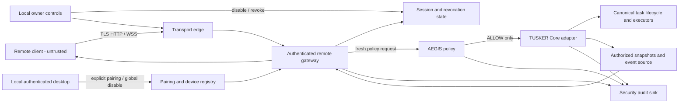

# PILOT-08 Remote-Control Threat Model & Abuse-Case Register

**Status:** Security analysis v0.1 — proposal for AEGIS-06 review; not an approval or implementation authorization  
**Owner:** PILOT-08 | **Branch:** `08-remote-control`  
**Contract baseline:** OpenAPI 0.1.0-draft; 72 protocol scenarios specified, not executed  
**Decision:** **NO-GO** until AEGIS-06 security decisions, TUSKER-04 final Core contract and NOVA-02 consent/recovery UX are closed.

## 1. Purpose and decision boundary

This document expands the remote-control threat model into explicit attacker profiles, assets, trust boundaries, attack trees, abuse cases, mitigations, residual risks and review evidence. It is a design-time security artifact. It does not select an unapproved implementation stack, prove a control works, approve a cryptographic protocol, or authorize runtime code.

The current Core decision record on `04-tusker-core` is **draft v0.1**. It records REVISE for task submission, state/projection, idempotency, cancellation, events/replay and trusted context; DEFER for pause/resume in MVP. It also states that remote approval remains disabled for MVP and that DENY/REQUIRE_APPROVAL must produce zero executor calls. Exact schemas, persistence and replay contracts remain open. AEGIS-06 identity, authorization and audit decisions remain independent mandatory gates.

## 2. System purpose, assets and security objectives

### 2.1 Protected assets

| Asset ID | Asset | Security objective | Sensitivity / impact |
|---|---|---|---|
| AST-01 | Local owner identity and authenticated desktop session | Only the local owner can initiate/confirm pairing and change local remote-access controls | Critical |
| AST-02 | Device private keys and server-side device registry | Preserve device authenticity; support reliable rotation and revocation | Critical |
| AST-03 | Session credentials, refresh/proof material and revocation state | Prevent theft, replay, cross-device use and resurrection | Critical |
| AST-04 | AEGIS policy inputs, decisions and policy availability | Ensure every operation is freshly authorized and fail-closed | Critical |
| AST-05 | Tusker Core tasks, state transitions and side effects | Preserve canonical task lifecycle; prevent unauthorized injection/control | Critical |
| AST-06 | Task prompts, context references, outputs, paths and evidence | Prevent cross-user/device disclosure and excess collection | High |
| AST-07 | Approval requests and decisions | Prevent unauthorized or replayed approvals; MVP remote approval disabled | Critical |
| AST-08 | Task events, sequence numbers, cursors and snapshots | Preserve confidentiality, integrity, ordering and recovery | High |
| AST-09 | Audit records and correlation context | Support accountability without leaking secrets or private content | High |
| AST-10 | Listener, TLS identity, network policy and global-disable state | Prevent unintended network exposure and provide emergency shutdown | Critical |
| AST-11 | Pairing challenges, QR/code payloads and pending enrollment state | Prevent guessing, replay, relay and unauthorized enrollment | Critical |
| AST-12 | Service availability and resource budget | Preserve local system usability under abuse | High |

### 2.2 Security invariants (non-negotiable)

1. Pairing starts from a locally authenticated session and requires explicit local confirmation of the specific remote device and requested scope.
2. Listener is loopback-only by default. Private-network exposure requires an explicit local opt-in; no public relay, UPnP, port-forwarding or silent VPN setup.
3. Every protected read and mutation is authenticated and freshly evaluated by AEGIS-06. Cached gateway decisions are not authority.
4. AEGIS DENY, REQUIRE_APPROVAL, timeout, malformed response or unavailable policy produces zero executor calls and no mutation.
5. Remote task submission is an adapter into the canonical TUSKER-04 Core lifecycle. Remote cannot choose tools, set risk, inject roles/policy outcomes or invoke executors directly.
6. Principal, origin, device/session and correlation context are injected server-side; client JSON and model output cannot override them.
7. Idempotency is principal-scoped. Same canonical payload resolves to the original task; conflicting payload conflicts. Uncertain dispatch is reconciled before retry.
8. Task projections and events are least-privilege, field-redacted and resource-authorized. A cursor is not an authorization credential.
9. Event gaps/reconnects recover from an authoritative authorized snapshot; duplicate delivery is tolerated; stale/invalid cursors are explicit.
10. Device/session revoke and local global disable invalidate HTTP and active WebSocket access, including in-flight mutation races according to a defined fail-closed boundary.
11. Remote approval remains disabled for MVP. No endpoint or hidden route may bypass this.
12. No remote shell, D-Bus, Polkit, SSH, privileged broker, direct NEXUS provider API or model-runtime administration surface.
13. Pause/resume is excluded from MVP unless TUSKER-04 later supplies safe checkpoint and recovery semantics.
14. Credentials, private prompts, raw tool output and hidden reasoning are not written to logs, URLs, analytics or default event projections.

## 3. Actors and attacker capability profiles

| Actor | Capabilities assumed | Limits / assumptions |
|---|---|---|
| ACT-01 Unauthenticated LAN attacker | Scan reachable ports; send arbitrary HTTP/WSS; manipulate headers; flood endpoints; attempt pairing guesses/replay | No valid device key, owner session or local confirmation |
| ACT-02 Malicious paired device | Hold its own valid device key/session; issue requests within attempted scope; replay, reorder and mutate its own traffic; subscribe to resources it guesses | Cannot be assumed honest merely because it was paired; cannot directly alter server-side policy |
| ACT-03 Stolen-device holder | Possess a paired endpoint, unlocked app state or extractable session material depending on platform compromise | May have valid credentials until expiry/revoke; secure storage is not assumed invulnerable |
| ACT-04 Stolen-token attacker | Possess a copied bearer/session credential but not necessarily device private key | Device proof-of-possession should limit usefulness; exact AEGIS contract pending |
| ACT-05 Compromised local user account | Operate within the user's desktop account, inspect user-readable files/processes and attempt local pairing/control | Does not automatically gain root or another user's authority; local account compromise is high impact and may defeat UI-only assumptions |
| ACT-06 Hostile browser origin / DNS rebinding site | Cause browser requests from hostile origins; exploit Host/Origin confusion, cookies, DNS rebinding and local-network access patterns | Browser-origin threat applies if browser clients or cookie auth are supported; native-client model still needs Host validation |
| ACT-07 Network MITM / hostile Wi-Fi | Observe, delay, drop, reorder or alter traffic; present invalid certificates; attempt downgrade | Correct TLS server authentication should prevent undetected content modification; denial remains possible |
| ACT-08 Malicious local process | Bind/scan local ports, send requests, race local state, inspect process-visible data subject to OS permissions | Loopback is not an authentication boundary; process isolation and OS account assumptions matter |
| ACT-09 Resource-exhaustion attacker | Open connections, flood handshakes, submit oversized bodies/events, force expensive authorization/replay work | Rate limits and quotas must be bounded and testable |
| ACT-10 Compromised remote client | Control app process and user-visible data on a paired endpoint; exfiltrate anything legitimately displayed; automate requests | Server must constrain scope and data; cannot protect data already disclosed to the endpoint |
| ACT-11 Physical-access attacker | Access unlocked host, boot alternate media, tamper with storage/network or observe pairing screen | Full physical compromise is not solved by the remote protocol; encrypted storage/OS controls are external prerequisites |
| ACT-12 Compromised dependency/build artifact | Supply malicious code or dependency behavior inside remote service/client | Supply-chain controls, pinned dependencies and reproducible/reviewed builds are required but outside protocol-only mitigation |

### 3.1 Assumptions

- TuskerOS is a single-owner workstation product for the MVP; multi-user semantics must be explicitly designed if that assumption changes.
- The local desktop login and OS account protections are functioning; account compromise is treated as a high-impact threat, not as a remote-authentication bypass to accept.
- TLS is mandatory for any non-loopback transport; there is no plaintext fallback.
- AEGIS-06 is the authoritative policy owner; PILOT-08 does not define or substitute its policy.
- TUSKER-04 owns canonical task lifecycle, persistence, event and cancellation semantics.
- The remote client is untrusted even after pairing and may be compromised.
- Network availability is not guaranteed; retries and reconnects must preserve safety under uncertainty.
- Platform key storage capabilities vary; no insecure fallback is silently enabled.

### 3.2 Explicit out of scope (not a claim of safety)

- Remote desktop/screen streaming, keyboard/mouse injection and unattended remote login.
- Public relay, cloud tunnel, router port forwarding and UPnP.
- Arbitrary shell, terminal, file-browser, D-Bus, Polkit or system administration access.
- Remote approval in MVP; any future approval capability requires a separate threat review.
- Defending a fully compromised kernel, root account, firmware or physical host.
- Protecting content after a legitimately authorized remote endpoint has displayed or copied it.
- Enterprise multi-tenant federation, internet-scale relay and cross-account sharing.

## 4. Trust boundaries, entry points and data flows

### 4.1 Boundary inventory

| Boundary | From → To | Untrusted input / risk | Required control owner |
|---|---|---|---|
| TB-01 | Remote device → network listener | Arbitrary packets, headers, TLS peers, payloads, connection floods | AEGIS-06 + PILOT-08 |
| TB-02 | Browser/native client → HTTP/WSS gateway | Origin/Host, cookies/tokens, JSON, frames, cursors, IDs | AEGIS-06 + PILOT-08 |
| TB-03 | Pairing UI → pairing/device registry | Human confirmation, QR/code, public key, device label, race/replay | AEGIS-06 + NOVA-02 |
| TB-04 | Session gateway → credential/device store | Credential validation, rotation, revocation races, persistence | AEGIS-06 |
| TB-05 | Gateway → AEGIS policy | Identity/action/resource/context and policy response | AEGIS-06 |
| TB-06 | Gateway → TUSKER Core | Task request, trusted context, idempotency, cancel/read | TUSKER-04 + AEGIS-06 |
| TB-07 | Core/event source → remote event gateway | Event contents, ordering, cursor, snapshot consistency | TUSKER-04 + PILOT-08 |
| TB-08 | Services → audit sink | Security events, correlation metadata, secret leakage | AEGIS-06 + TUSKER-04 |
| TB-09 | Service process → host/network configuration | Bind address, TLS files, service identity, firewall and disable state | AEGIS-06 + PHOENIX-10 + ATLAS-01 |
| TB-10 | Remote endpoint display/storage | Authorized data leaves host trust domain | User/device owner; minimize disclosure |

### 4.2 Data-flow sketch



The diagram is logical, not a process topology or authorization design. AEGIS and Core contracts determine actual call boundaries. No arrow from the remote gateway to an executor or privileged broker is permitted.

### 4.3 Entry-point inventory

- HTTP routes: pairing completion, session establishment/rotation/revoke, device list/revoke, status, task list/detail/submit/cancel, optional audit view.
- WebSocket handshake, subprotocol negotiation, Origin/Host, frames, ping/pong, cursor/resume parameters and close handling.
- Local desktop pairing challenge creation/confirmation/cancel, device inventory, revoke and global disable.
- Persistent stores: device keys/metadata, hashed credentials, revocation epoch/state, idempotency records, task snapshots/events and audit records.
- Deployment: listener bind address, TLS certificate/key paths, reverse proxy settings, firewall profile, systemd unit identity, service restart and uninstall/upgrade.
- Observability: logs, metrics, traces, crash reports and support bundles.

No route list is final until OpenAPI and WebSocket contracts are reconciled with owner decisions.

## 5. STRIDE analysis by boundary

| STRIDE | Representative remote-control threat | Primary mitigations | Residual concern |
|---|---|---|---|
| Spoofing | Fake device, stolen session, spoofed principal, hostile Host/Origin | Device proof-of-possession; session-device binding; server-derived principal; strict TLS/Host/Origin; local pairing confirmation | AEGIS credential and browser model not approved |
| Tampering | Modify task payload, idempotency key, event cursor, approval decision or policy context | TLS; strict schemas; canonical payload digest; server-injected context; immutable event IDs/sequences; no remote approval in MVP | Canonicalization and replay contract open |
| Repudiation | Deny having paired, submitted, cancelled or revoked | Structured audit with actor/device/session/action/outcome/correlation/time; protected retention | Audit schema/retention and clock semantics await AEGIS |
| Information disclosure | Read another task, hidden prompt/output, event stream, device inventory or token | Per-request authorization; owner/resource scoping; field allowlists/redaction; cursor not authority; secret-safe logs | Exact field-level policy and device scope open |
| Denial of service | Pairing brute force, connection flood, expensive replay, oversized frames or authorization amplification | Rate/concurrency/size/time limits; backoff; bounded pagination/replay; per-device quotas; loopback default | Capacity thresholds and fairness need measurement |
| Elevation of privilege | Client-supplied role, direct tool selection, approval bypass, stale policy or Core bypass | AEGIS on every operation; deny/approval => zero executor calls; Core-only lifecycle; no privileged endpoints; fail closed | Policy API and Core contract remain unapproved |

## 6. Attack trees

### AT-01 — Enroll an unauthorized device

**Goal:** obtain a registered device identity without informed local-owner consent.

```text
Unauthorized device enrollment
  OR
  ├─ Guess or brute-force pairing challenge
  │   ├─ exploit low entropy / long validity
  │   ├─ bypass rate limits
  │   └─ race concurrent completion attempts
  ├─ Replay or relay a valid challenge
  │   ├─ reuse after successful enrollment
  │   ├─ complete from a different key/device
  │   └─ exploit missing server/device/channel binding
  ├─ Trick owner into confirming wrong device
  │   ├─ spoof device label
  │   ├─ hide requested scope / confirmation origin
  │   └─ exploit ambiguous desktop UI
  └─ Abuse compromised local account or pairing process
      ├─ initiate pairing without owner awareness
      └─ tamper with pending challenge state
```

**Required barriers:** locally authenticated initiation; explicit confirmation showing stable device identity/fingerprint and requested scope; high-entropy short-lived one-use challenge; proof bound to server, device key and challenge; rate limit; atomic consume; cancel/expiry invalidation; audit.  
**Residual:** social engineering and compromised local account remain high impact. Exact ceremony/entropy/limits require AEGIS-06 and NOVA-02 approval.

### AT-02 — Inject a task or escalate task authority

**Goal:** cause a task to execute with authority the paired device/user does not possess.

```text
Unauthorized task execution / privilege escalation
  OR
  ├─ Spoof identity or role in request JSON
  ├─ Bypass AEGIS or reuse stale ALLOW
  ├─ Submit tool name / risk / executor selector directly
  ├─ Exploit idempotency collision or retry race
  ├─ Confuse Core origin / context-reference authorization
  └─ Reach executor, shell, D-Bus, Polkit or NEXUS API directly
```

**Required barriers:** derive principal/device/origin server-side; reject unknown fields; fresh AEGIS authorization on each attempt; DENY/REQUIRE_APPROVAL => zero executor calls; Core-only lifecycle; principal+key idempotency with canonical payload comparison; bounded/authorized context refs; no privileged route.  
**Residual:** policy/Core contract gaps and unknown dispatch outcomes can create unsafe retries unless persistence and reconciliation are proven.

### AT-03 — Read another task or leak event data

**Goal:** disclose task content, private prompt, path, output, evidence or event metadata.

```text
Cross-resource or sensitive-data disclosure
  OR
  ├─ Guess task/resource ID and exploit missing ownership check
  ├─ Subscribe to another task's event stream
  ├─ Replay cursor under a different principal/device
  ├─ Exploit over-broad projection or arbitrary event payload
  ├─ Read stale cache after permission/revocation change
  └─ Extract secrets from logs, traces, URLs or crash reports
```

**Required barriers:** authorize every resource read/subscription/replay; cursor bound to principal/resource/version but never used as authority; field allowlist and redaction; snapshot watermark and explicit stale-cursor handling; revalidate on reconnect; redact telemetry.  
**Residual:** data already displayed on a compromised paired endpoint cannot be recalled.

### AT-04 — Survive device/session revoke or local global disable

**Goal:** continue reading or mutating after owner revokes access.

```text
Persistence after revoke / disable
  OR
  ├─ Keep existing WebSocket alive after revoke
  ├─ Race mutation between authorization and revoke commit
  ├─ Reuse rotated/revoked token or stale refresh proof
  ├─ Restore old session state after service restart
  ├─ Exploit eventual cache invalidation
  └─ Disable UI only while listener/session remains active
```

**Required barriers:** atomic authoritative revoke/disable state; generation/epoch check at operation boundary; active WS close and subsequent frame rejection; revoke all associated sessions; define in-flight mutation linearization point; durable state/restart semantics; local-only global disable blocks new handshakes and mutations.  
**Residual:** exact race bound and behavior during policy/store outage need AEGIS decisions and concurrency tests.

### AT-05 — Expose service or exhaust host resources

**Goal:** reach the service from an unintended network or make it unavailable.

```text
Network exposure / denial of service
  OR
  ├─ Listener binds wildcard by default
  ├─ Installer/firewall opens LAN or public port
  ├─ DNS rebinding / Host confusion reaches loopback service
  ├─ TLS downgrade or certificate-validation bypass
  ├─ Exhaust HTTP/WSS connections or pairing attempts
  └─ Force unbounded body, frame, event replay or pagination work
```

**Required barriers:** loopback default; explicit opt-in for private interface; no UPnP/port forwarding/public relay; mandatory TLS for non-loopback; Host/Origin validation and trusted-proxy allowlist; request/frame/time/concurrency limits; bounded replay/pagination; rate limit and safe shutdown.  
**Residual:** LAN exposure depends on installer/firewall integration and actual deployment topology.

### AT-06 — Obtain or abuse remote approval

**Goal:** make a privileged action execute through a forged, stale or over-broad remote approval.

```text
Remote approval abuse
  OR
  ├─ Call hidden/unlisted approval endpoint
  ├─ Replay approval nonce or decision
  ├─ Approve different action/resource/input than shown
  ├─ Use stale approval after policy/context change
  └─ Forge approver identity or bypass AEGIS
```

**MVP barrier:** remote approval is disabled; no route, UI affordance or implicit approval fallback exists. AEGIS DENY/REQUIRE_APPROVAL must result in zero executor calls.  
**Future-only requirements:** separate threat review; bind decision to exact action/resource/input digest, actor, device/session, expiry, policy version and audit reference; single-use nonce; fresh AEGIS validation.  
**Residual:** any accidental endpoint or fallback path is a release blocker; route inventory and negative tests must prove absence.

## 7. Abuse-case register

Risk ratings are provisional design-time judgments, not measured likelihoods. P0 means block implementation/release until the control and evidence are owner-approved.

| ID | Preconditions and abuse steps | Impact | Prevention / detection / response | Linked verification / requirement | Owner / status / residual |
|---|---|---|---|---|---|
| AB-01 Pairing brute force | Listener reachable; attacker guesses challenges or floods completion | Unauthorized enrollment | High entropy, short expiry, one-use atomic consume, rate limit, generic errors; alert on failures; throttle/disable pairing | PAIR-002..006, NET-006; RC-DEVICE-01 | AEGIS + PILOT; OPEN; P0 |
| AB-02 Pairing relay / wrong-device confirmation | Valid pending challenge; attacker relays proof or spoofs label | Persistent attacker device | Bind challenge to server/key/nonce; show fingerprint and scope locally; cancel/expire; audit enrollment | PAIR-003..010; RC-DEVICE-01 | AEGIS + NOVA; OPEN; P0 |
| AB-03 Stolen device credential | Device or token copied; attacker authenticates/replays | Unauthorized reads/mutations | Proof-of-possession, secure storage, bounded session, device binding, revoke; anomaly audit; revoke/re-pair | SESS-001..014; RC-SESSION-01 | AEGIS; OPEN; P0 |
| AB-04 Client-supplied principal/role | Paired client sends another principal, role or ALLOW claim | Cross-user action / privilege escalation | Derive all authority server-side; reject extra fields; AEGIS per request; zero executor calls on deny | AUTH-001..010, TASK-016; RC-AUTH-01 | AEGIS + TUSKER; REVISE; P0 |
| AB-05 Direct tool/executor injection | Client submits tool, risk, provider or command selector | Arbitrary privileged execution | Strict submission schema; adapter-only Core API; no shell/broker/provider route; route inventory | AUTH-010, TASK-006; RC-PRIV-01 | TUSKER + AEGIS; OPEN; P0 |
| AB-06 Idempotency collision/replay | Duplicate or conflicting requests share key; dispatch outcome uncertain | Duplicate side effects or lost task | Principal-scoped canonical digest; durable record; conflict response; reconciliation before retry; audit correlation | TASK-002..005, TASK-012..014; RC-TASK-02 | TUSKER; REVISE; P0 |
| AB-07 Context-reference substitution | Client references another user's file/task/context | Data disclosure or unauthorized task context | Core validates every reference for principal/device scope; bounded references; redact errors | TASK-007..008; RC-TASK-01/03 | TUSKER + AEGIS; OPEN; P0 |
| AB-08 Unauthorized task read | Guess task ID or enumerate pagination | Private prompt/output/path disclosure | Per-read AEGIS and ownership checks; minimal projection; bounded pagination; alert repeated denials | AUTH-004, EVT-001..002; RC-TASK-03 | AEGIS + TUSKER; REVISE; P0 |
| AB-09 Event subscription/cursor theft | Reuse cursor or subscribe to another resource/device | Event leakage or replay confusion | Authorize subscription/replay; cursor is not bearer authority; bind scope; snapshot resync; revoke closes stream | EVT-003..012, SESS-010..014; RC-EVENT-01/02 | AEGIS + TUSKER; REVISE; P0 |
| AB-10 Event gap/sequence manipulation | Drop, duplicate or reorder events; stale cursor used | Client displays false task state | Unique event ID, monotonic per-task sequence, explicit gap detection, authoritative snapshot; telemetry on resets | EVT-004..007; RC-EVENT-02 | TUSKER; REVISE; P0 |
| AB-11 Revoked session persists | Keep WS open or race mutation after revoke | Continued unauthorized access | Durable revoke/epoch; recheck at mutation boundary; close active WS; define in-flight linearization; restart tests | SESS-008..014, NET-009; RC-SESSION-01 | AEGIS; OPEN; P0 |
| AB-12 Host/Origin/DNS rebinding | Hostile browser site reaches loopback or trusted proxy misroutes | CSRF, credential abuse, unintended local access | Strict Host/Origin allowlist; no wildcard CORS; explicit cookie/CSRF model; trusted proxy list; reject rebinding | NET-001..005; RC-TRANSPORT-01 | AEGIS + PILOT; OPEN; P0 |
| AB-13 LAN/public exposure | Service binds wildcard or installer opens firewall | Remote attack surface exposed without consent | Loopback default; local opt-in; TLS; firewall/service tests; no UPnP/port forwarding; emergency disable | NET-001..010; RC-TRANSPORT-02 | AEGIS + PHOENIX + ATLAS; OPEN; P0 |
| AB-14 Resource exhaustion | Flood handshakes, WS frames, large requests or replay range | Local service/system unavailable | Bounded body/frame, connection/time limits, rate quotas, backpressure, bounded replay; metrics and throttle | NET-006..010; RC-TRANSPORT-02 | PILOT + AEGIS; OPEN; P0 |
| AB-15 Audit/diagnostic leakage | Secrets or task content enter logs/traces/support bundles | Credential compromise / privacy breach | Field allowlist; redaction tests; no URL tokens; access-controlled retention; incident response rotate/revoke | SESS-014, TASK-016; RC-AUDIT-01 | AEGIS + TUSKER; OPEN; P0 |
| AB-16 Approval bypass | Hidden route, replayed decision or REQUIRE_APPROVAL fallback | Unauthorized privileged side effect | MVP route absent; remote approval disabled; policy denial/approval yields zero executor calls; route-negative tests | AUTH-006..010 and conditional approval suite; RC-APPROVAL-01 | AEGIS; DEFERRED/DISABLED for MVP; P0 |
| AB-17 Global disable bypass | UI toggle hides feature but service/session remains usable | Owner cannot stop remote access | Local authoritative disable; invalidate sessions and WS; listener/handshake and mutation checks; clear re-enable flow | PAIR-010, SESS-013, NET-010; RC-DEVICE-02 | AEGIS + NOVA; OPEN; P0 |
| AB-18 Local account/process abuse | Compromised user process initiates pairing or accesses loopback | Owner-level remote trust abuse | Local authenticated consent, OS process/account boundary, visible connection state, audit; revoke and rotate on compromise | PAIR-001, PAIR-008..010; RC-DEVICE-01 | AEGIS + NOVA; OPEN; High |
| AB-19 Uncertain cancel/dispatch race | Network loss after mutation; client retries or assumes stop | Duplicate work or misleading state | Core idempotency/reconciliation; accepted vs confirmed cancel; explicit unknown outcome; never blind retry | TASK-009..015; RC-TASK-02/04 | TUSKER; REVISE; P0 |
| AB-20 Compromised paired endpoint | Malware reads legitimate task projection or screenshots | Disclosure of data already shown | Least data, per-device scope, visible device inventory/revoke, session expiry; incident response revoke and rotate | AUTH-004, EVT-002, SESS-008; RC-TASK-03 | AEGIS + NOVA; OPEN; High |

## 8. Mitigation requirements and validation evidence

### 8.1 P0 control/evidence matrix

| Control ID | Required control | Owner | Minimum evidence required before GO |
|---|---|---|---|
| CTRL-01 | Pairing ceremony and proof-of-possession | AEGIS-06 + NOVA-02 | Approved protocol/UX, parameter values, replay/race/rate-limit tests |
| CTRL-02 | Device key/session lifecycle and secure storage | AEGIS-06 | Approved algorithms and credential model, storage/fallback policy, rotation/revoke tests |
| CTRL-03 | Fresh AEGIS policy on every protected operation/retry | AEGIS-06 | Normative request/response/error contract; timeout/unavailable/deny/approval tests prove zero executor calls |
| CTRL-04 | Core-only task lifecycle and trusted context | TUSKER-04 + AEGIS-06 | Final adapter/schema, server-injected identity/origin, route inventory and integration tests |
| CTRL-05 | Durable idempotency and unknown-outcome reconciliation | TUSKER-04 | Persistence/restart/race contract and tests; no blind retry |
| CTRL-06 | Redacted snapshots and resource-scoped event stream | AEGIS-06 + TUSKER-04 | Field-level schema, per-resource auth, cursor/replay/snapshot tests |
| CTRL-07 | Revocation and emergency global disable | AEGIS-06 + NOVA-02 | Defined atomicity/race bound; HTTP + active WS closure; restart and disable/re-enable tests |
| CTRL-08 | TLS, Host/Origin, listener and deployment profile | AEGIS-06 + PHOENIX-10 + ATLAS-01 | Approved network profile; bind/firewall inspection; invalid TLS/Host/Origin/downgrade tests |
| CTRL-09 | Abuse resistance and bounded resource use | AEGIS-06 + PILOT-08 | Numerical limits, rate/concurrency tests, backpressure and safe failure behavior |
| CTRL-10 | Secret-safe audit and diagnostics | AEGIS-06 + TUSKER-04 | Approved event schema/retention; automated redaction scan and access-control evidence |
| CTRL-11 | Remote approval absent in MVP | AEGIS-06 | API route inventory and negative tests; DENY/REQUIRE_APPROVAL produce zero executor calls |
| CTRL-12 | No shell/broker/provider bypass | AEGIS-06 + TUSKER-04 | Route/process capability inventory and negative integration tests |

### 8.2 Validation sequence

1. Freeze owner-approved contracts and exact parameter values.
2. Validate OpenAPI and separately validate the normative WebSocket/AsyncAPI contract; resolve all API-01..API-24 findings.
3. Turn all 72 existing protocol scenarios and the abuse cases above into executable tests; add explicit concurrency, persistence/restart, revocation race and resource-exhaustion tests.
4. Run unit, integration, adversarial, static-analysis, dependency and secret-scanning checks on the chosen stack.
5. Test deployment on a clean install: listener address, firewall behavior, TLS identity, service user, key permissions, disable, upgrade, rollback and uninstall.
6. Obtain AEGIS-06 security sign-off, TUSKER-04 Core contract sign-off and NOVA-02 consent/recovery UX sign-off; record residual risk owners and explicit acceptance.
7. PILOT-08 publishes a signed GO/NO-GO record. Any changed threat boundary returns to review.

**Current evidence:** 72 scenarios are written but not executed; zero tests run; OpenAPI validator not run; zero runtime features; no AEGIS-06 or NOVA-02 sign-off. Static documents are not security validation.

## 9. Residual risk register

| Risk ID | Residual risk after proposed controls | Provisional rating | Accountable owner | Required disposition |
|---|---|---|---|---|
| RR-01 | Compromised local account can initiate/confirm pairing and access owner-level data | Critical | AEGIS-06 + NOVA-02 | Explicit threat acceptance and local recovery guidance |
| RR-02 | Compromised paired endpoint can copy any data legitimately disclosed to it | High | AEGIS-06 + product owner | Minimize projections; communicate device trust model |
| RR-03 | Revocation cannot undo a mutation already committed before revoke linearization | High | AEGIS-06 + TUSKER-04 | Define linearization point, user-visible outcome and audit evidence |
| RR-04 | Platform secure-storage availability differs; fallback may weaken key protection | High | AEGIS-06 + ATLAS-01 | Approve supported platforms and fail-closed/fallback policy |
| RR-05 | LAN availability and local firewall/proxy configuration can expose an opted-in listener | High | AEGIS-06 + PHOENIX-10 | Deployment threat review and clean-install tests |
| RR-06 | Denial of service remains possible even with limits, especially on constrained devices | Medium | PILOT-08 + AEGIS-06 | Measure resource budgets and document safe degradation |
| RR-07 | Event retention/cursor expiration can force snapshot recovery and transient UI staleness | Medium | TUSKER-04 | Define replay window, snapshot consistency and user-visible reset |
| RR-08 | Clock skew and sleep/resume can affect expiry and reconnect semantics | Medium | AEGIS-06 + TUSKER-04 | Server-authoritative time and skew tests |
| RR-09 | Future remote approval would materially increase privilege and social-engineering risk | Critical | AEGIS-06 | Keep disabled in MVP; separate future threat review |
| RR-10 | Supply-chain compromise of service/client dependency can subvert controls | High | AEGIS-06 + PHOENIX-10 + ATLAS-01 | Dependency provenance, pinning, review and release integrity |

Ratings are preliminary and intentionally conservative. No residual risk has been accepted by its named owner.

## 10. Security-owner review checklist

### AEGIS-06 — required response

For each item, provide **ACCEPT / REVISE / DEFER**, authoritative schema/ADR link and any exact numeric values:

- [ ] Pairing ceremony, challenge entropy/expiry, attempt limits, proof-of-possession and key rotation (DEC-AEG-001/002).
- [ ] Credential type, device/session binding, token lifetime/idle expiry/rotation and secure storage/fallback (DEC-AEG-003).
- [ ] Per-request policy interface, mandatory inputs, decision semantics, timeout and fail-closed behavior (DEC-AEG-004).
- [ ] Revocation, active WSS termination, in-flight mutation boundary and restart behavior (DEC-AEG-005).
- [ ] Audit fields, denied-attempt logging, redaction, retention and access (DEC-AEG-006).
- [ ] TLS, certificate trust, Host/Origin/proxy, listener, rate/size/concurrency limits (DEC-AEG-007).
- [ ] Remote approval explicitly disabled for MVP; no route/UI/fallback (DEC-AEG-008).

### TUSKER-04 — Core contract closure

Current owner decision record: `tusker-core/REMOTE-DECISIONS.md` on `04-tusker-core`, draft v0.1:
- DEC-TUS-001..004, 006..007 = REVISE; schemas/semantics still open.
- DEC-TUS-005 = DEFER; pause/resume excluded from MVP.
- Core invariants include adapter-only path, trusted context injection, zero executor calls on DENY/REQUIRE_APPROVAL, reconciliation of uncertain mutation outcomes and snapshot recovery.

Required next evidence: final schemas and API, durable idempotency/reconciliation behavior, cancellation race tests, event cursor/replay semantics, field-level projection and AEGIS audit mapping.

### NOVA-02 — local consent and recovery UX

- [ ] Pairing initiation/confirmation/cancel/expiry flow and clear device identity.
- [ ] Device inventory, revoke and lost-device recovery.
- [ ] Visible connection state and local global disable/enable.
- [ ] Private-network opt-in and safe loopback fallback.
- [ ] Explicit UX sign-off; no approval UI in MVP.

### PILOT-08 disposition

**NO-GO remains.** This register is a threat-analysis proposal for review. It creates no new authorization and does not supersede AEGIS-06, TUSKER-04 or NOVA-02 ownership.

## 11. Change history

- v0.1 (2026-10-31): Initial expanded threat model, attacker profiles, trust boundaries, six attack trees, twenty abuse cases, mitigation/evidence matrix and residual risk register. Incorporated the current TUSKER-04 draft decision dispositions without treating them as final contract approval.
